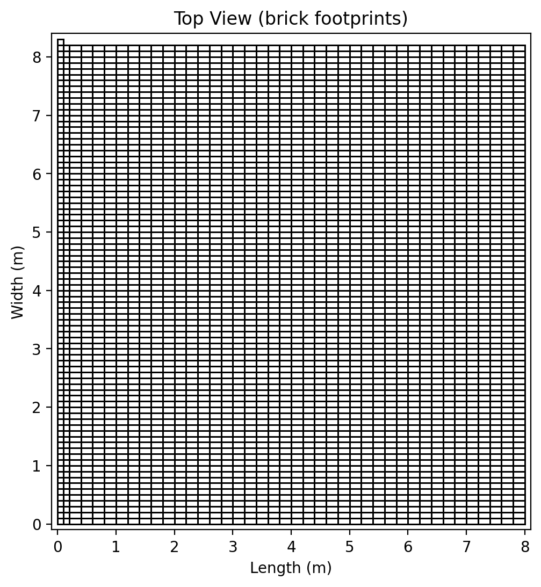
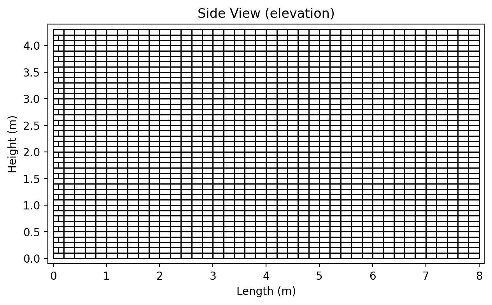

# Brick Cuboid 100mm 3D Generation and Visualization

A geometric generation and volumetric visualization pipeline for 3D brick structures. Calculates spatial coordinates, generates structured CSV/JSON point definitions, and renders 3D polygonal projections with Matplotlib.





## Pipeline Overview

1. Coordinate Generation (`main.py`): Generates geometric grid representations for 3D stacked blocks across specified Cartesian axes (`nx`, `ny`, `nz`) with customizable dimension vectors.
2. Serialization: Outputs structured geometry into `out/bricks.csv` and `out/bricks.json`.
3. 3D Render Engine (`visualize.py`): Reconstructs 8-vertex bounding cuboids with 6-face polygons and renders isometric perspectives using `mpl_toolkits.mplot3d.art3d.Poly3DCollection`.

## Installation and Execution

### Prerequisites

- Python 3.9+
- Dependencies: `pandas`, `matplotlib`

```bash
pip install pandas matplotlib
```

### Generating Geometry and Visualizations

```bash
# Generate spatial coordinate dataset
python main.py

# Render 3D isometric and elevation graphics
python visualize.py
```
